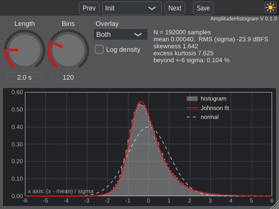

# AmplitudeHistogram

Histogram of the input amplitudes, an estimate of the probability density function (pdf), with mean,
RMS level, skewness and excess kurtosis. Overlays: the normal pdf and the Johnson pdf with the measured
skewness and excess kurtosis. The audio passes unchanged (no latency).
Part of [noise_moments](../README.md); the manual is in `docs/manual/` (PDF).

## Controls
| Control | Range | Default | Description |
|---|---|---|---|
| Length | 0.1 s - 10.0 s | 2.0 s | Analysis length: the histogram is made of the last samples of this duration (all channels). Longer = smoother histogram, but slower to follow changes. |
| Bins | 10 - 400 | 120 | Number of bins from -6 to +6 sigma (120: bin width 0.1 sigma). More bins = finer, but each bin counts fewer samples (noisier). |
| Overlay | None - Both | Both | Curves drawn over the histogram: the normal pdf and/or the Johnson pdf with the measured skewness and excess kurtosis. |
| Log density | Off - On | Off | Density axis logarithmic (shows the tails) or linear. |

(generated with `AmplitudeHistogram_Tester --manual md`)

## Defaults
2 s and 120 bins: with stereo at 48 kHz that is 192 000 samples; a bin of width 0.1 sigma at the centre
counts about 7 700 samples (random error about 1 %), so the shape of the pdf is visible without noise,
and the display still follows a change within 2 s. (Rules like Scott's or Freedman-Diaconis' give
150 - 250 bins for this N; they minimize the error of a density estimate, but the histogram looks noisier.)

## Notes
- All input channels are pooled (stereo: twice the samples). The x axis is (x - mean) / sigma, the
  same as in MomentNoise, so both displays can be compared directly.
- The histogram is updated 10 times per second while the window is open (no analysis without window).
- Skewness and kurtosis estimates scatter a lot for heavy-tailed signals: a few large peaks decide them.

## Development
Made from the AdvancedAudioTemplate (AAT2): `AmplitudeHistogram.h/.cpp` hold parameters, analysis and
GUI; the distribution code is in `../shared/`. Template documentation: `HowToTestYourPlugin.md`,
`docs/HowToDoc.md` and the [template README](https://github.com/JoergBitzer/AdvancedAudioTemplate/tree/AAT2).
