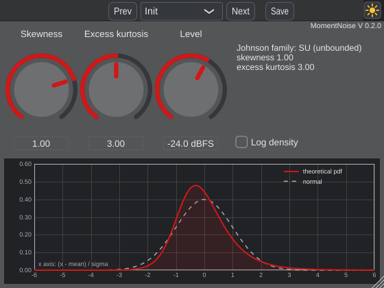

# MomentNoise

Noise generator with adjustable **skewness** and **excess kurtosis**. Default: Gaussian noise at
-24 dBFS RMS. The lower half of the window shows the theoretical probability density function (pdf).
Part of [noise_moments](../README.md); the manual is in `docs/manual/` (PDF).

## Controls
| Control | Range | Default | Description |
|---|---|---|---|
| Skewness | -2.00 - 2.00 | 0.00 | Asymmetry of the amplitude distribution (3rd standardized moment): 0 = symmetric, positive = long tail towards positive amplitudes. |
| Excess kurtosis | -1.50 - 100.00 | 0.00 | Tail weight (4th standardized moment minus 3): 0 = Gaussian, negative = light tails (uniform: -1.2), positive = heavy tails, rare large peaks (Laplace: 3). At least skewness squared - 1.5, smaller values are raised. |
| Level | -60.0 dBFS - 0.0 dBFS | -24.0 dBFS | RMS level of the noise (its standard deviation). Heavy tails give peaks far above the RMS level: they may exceed 0 dBFS. |
| Log density | Off - On | Off | Density axis of the display logarithmic (shows the tails) or linear. |

(generated with `MomentNoise_Tester --manual md`)

## Notes
- A generator: the input is replaced; every channel gets its own (uncorrelated) noise. No latency.
- The info text shows the Johnson family (SN, SL, SU, SB) and the reached moments; an excess kurtosis
  below skewness^2 - 1.5 is raised (the theoretical bound is skewness^2 - 2).
- Heavy tails: at -24 dBFS and excess kurtosis 100, single peaks within 10 s reach +7 to +15 dBFS
  (about 35 dB above the RMS level; at excess kurtosis 15 about +5 dBFS). Such noise sounds like crackles.
- The Excess kurtosis knob is exponential (`tools/ExponentialRange.h`) with 3 in the middle: 0 at about
  34 %, 10 at 65 %, 25 at 78 % of the turn. Above about 50, a few seconds of noise measure clearly less
  than the set value (the kurtosis depends on very rare, very large samples).
- How it works: see the top-level README and the manual.

## Development
Made from the AdvancedAudioTemplate (AAT2): `MomentNoise.h/.cpp` hold parameters, algorithm and GUI;
the distribution code is in `../shared/`. `tools/ExponentialRange.h` and the
`jade::makeParameter(spec, range)` overload in `tools/ParameterSpec.h` were added to the template copy for the
exponential knob of Excess kurtosis. Template documentation: `HowToTestYourPlugin.md`,
`docs/HowToDoc.md` and the [template README](https://github.com/JoergBitzer/AdvancedAudioTemplate/tree/AAT2).
